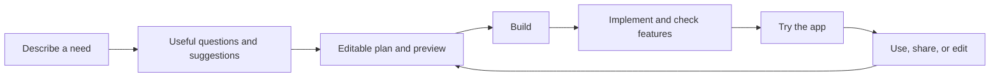

# BuildAI: product and systems requirements

## 1. Product goal and release scope

**BuildAI should let a nontechnical person describe a useful phone capability, refine it with an AI, and get a reliable personal app—privately and locally when requested.**

The longer-term vision is an AI that becomes part of how someone uses their phone: creating tools, organizing information, connecting approved services, and managing routines. The first release establishes the builder, runtime, and Android integrations needed to grow toward that vision.

### Target users

- People who want a specific personal tool but cannot program it.
- Privacy-conscious users who want local AI and local data.
- Students and hobbyists building study tools, schedules, trackers, and small games.
- Community contributors extending the supported capabilities.

Your CV focus is **AI agent engineering**: how the system understands requirements, uses tools, remembers decisions, verifies results, and operates within phone constraints.

### First release

The release must support:

- Separate private-chat and app-creation modes.
- Guided requirements gathering, useful suggestions, and one editable plan before building.
- Custom apps composed from reusable screens, data, calculations, actions, and Android capabilities.
- Full-screen app launching, home-screen shortcuts, actionable widgets, and scheduled reminders.
- Background chat/build jobs that survive navigation.
- Feature-level editing, saved revisions, and rollback.
- Local GGUF inference, with optional cloud AI and explicitly enabled connections.
- Open app bundles that another BuildAI installation can import.

Apps must continue working without an AI model loaded unless a particular feature needs inference.

Examples used to prove the system’s flexibility:

| Example | Required behavior |
|---|---|
| Study companion | Notes, search, tags, reviewed AI organization, quizzes, and study reminders. |
| Personal routine planner | Custom routines, schedules, focus timers, snooze actions, and an agenda widget. |
| Custom personal toolkit | User-defined forms, stored records, calculations, summaries, and shortcuts to common actions. |

These are demonstration scenarios. The builder must allow different combinations of capabilities, rather than funneling every idea into these three apps.

### Findings from the prototype

Repository inspection supports several structural causes:

| Reported problem | Required change |
|---|---|
| Back cancels a reply | Move job ownership outside screen/view-model lifetimes. |
| Progress depends on “Review my plan” | Use an explicit requirements state and readiness checks. |
| Active builds stop after three minutes | Replace the overall deadline with progress-aware stall detection. |
| Editing replaces the whole app | Apply scoped changes to versioned app definitions. |
| Completed apps remain inside a cramped preview | Separate builder previews from full-screen app execution. |

The particular margin failure still needs reproduction. It becomes a regression case, rather than an assumed diagnosis.

### Research informing the design

| Reference | What BuildAI should learn |
|---|---|
| [Anthropic’s long-running agent experiments](https://www.anthropic.com/engineering/effective-harnesses-for-long-running-agents) | Maintain feature requirements, work incrementally, save progress, and verify interactions before declaring completion. |
| [Replit’s Flash News case](https://replit.com/blog/building-mobile-apps-on-replit) | Nontechnical creation benefits from brainstorming, structured requirements, and repeated testing on the actual phone. This is a vendor-reported cloud-builder case, not evidence of equivalent local-model performance. |
| [TinyAI](https://github.com/YashBhadange2006/TinyAI) | Model setup, stoppable streaming, and persistent sessions are useful mobile patterns. Its inference formats differ from BuildAI’s GGUF path. |
| [PocketPal AI](https://github.com/a-ghorbani/pocketpal-ai) | On-device tools and model benchmarking provide relevant examples for inference UX and resource measurement. |
| [AutoDroid-V2](https://arxiv.org/abs/2412.18116) | Small models can benefit from narrowly documented capabilities. Its subject is operating existing apps, which belongs to BuildAI’s later roadmap. |

The proposed adaptation is a controlled agent workflow with tested capabilities. Its effectiveness must be measured on your phone.

## 2. User experience and functional requirements

### Screens and navigation

Use three main destinations: **Apps, Assistant, Activity**. Settings is accessible from the main screens.

| Screen | Purpose and behavior |
|---|---|
| First-run setup | Explain local versus connected operation; recommend a model, show download size, and offer import. Existing apps can run without downloading a model. |
| Apps | Show installed apps and separate drafts. Provide Create, Import, Open, Edit, Add shortcut, and Add widget. |
| Assistant | Offer clearly labeled Chat and Create modes, saved conversations, editable drafts, and visible local/cloud status. |
| Project workspace | Combine conversation, requirements, plan, and preview under one project. Users can revisit any part without losing work. |
| Plan and preview | Show features, screens, data, assumptions, permissions, and unresolved questions. Offer direct edits and one Build action. |
| Activity | Show queued, running, waiting, interrupted, failed, and completed jobs across projects. |
| App runner | Launch the actual app full-screen, independently of builder controls. Preserve state when leaving. |
| Edit and history | Show proposed feature changes, a working preview, Apply changes, and previous revisions. |
| Models and connections | Manage downloads, imports, compatibility checks, credentials, and enabled capabilities. |

### Creation flow

**UX-01 — Relevant questions.** Track answers and unresolved decisions. Ask questions that change functionality, data, behavior, or integrations. Avoid repeating answered questions. Explicitly honor “ask me questions.”

**UX-02 — Responsible suggestions.** Offer a few relevant enhancements, explain their benefit, and distinguish suggestions from requested requirements. Do not silently add unrelated features.

**UX-03 — Real planning.** Produce a feature-specific plan containing user workflows and observable acceptance checks. Combining chat messages into a description does not count as planning.

**UX-04 — Readiness.** Automatically offer the plan when essential decisions are resolved. Users can request it earlier with visible assumptions. No special phrase or message count unlocks progress.

**UX-05 — One build approval.** Requirements and design remain editable together. Build starts implementation and verification; users need not approve every internal step.

**UX-06 — Continuous input.** Typing remains available during replies and builds. Further messages can queue; Stop and revise is explicit. New input must not silently disappear or overwrite an active build’s requirements.

**UX-07 — Editable voice.** Recording and transcription have visible stop controls. Transcription enters the composer and is never sent automatically. Strict-private mode uses on-device recognition only; typing remains available when it is unsupported.

**UX-08 — Navigation independence.** Back, switching projects, and opening another app detach the current screen without cancelling its job. Cancellation is a distinct action.

**UX-09 — Honest progress.** Display concrete activity such as “reading requirements,” “adding the timer,” or “checking saved notes.” Avoid fabricated percentages and unsupported time estimates.

**UX-10 — App-like execution.** Generated apps open full-screen with correct system-bar, keyboard, and display-cutout handling. Builder toolbars appear only in the workspace.

**UX-11 — Targeted edits.** “Add search” changes search-related parts. Existing records and unrelated features remain intact. Show the change summary and preview before applying the revision.

**UX-12 — Understandable failure.** Identify the failed feature, preserve the working revision, and offer a specific recovery action. Never substitute a generic list app and call the request completed.

Use native Android styling, accessible labels, at least 48 dp touch targets, scalable text, and sufficient contrast. Themes support usability but are secondary to useful capabilities.

## 3. Architecture and system requirements

### A. Structured app runtime

Retain Kotlin, Compose, and llama.cpp. Introduce a **versioned app definition**, called `AppSpec`, rendered by tested native components.

The model describes and changes an app. BuildAI supplies the dependable implementation of supported components.

Initial building blocks:

- Layouts, navigation, text, forms, lists, search, filters, and summaries.
- Typed records, relationships, sorting, and local persistence.
- Arithmetic, comparisons, dates, conditional actions, and calculated fields.
- Notes, timers, schedules, notifications, and widget actions.
- Quiz and simple turn-based puzzle components.
- Explicit AI actions, such as proposing tags for selected notes.

Use bounded, typed expressions and actions. Imported bundles cannot introduce arbitrary JavaScript, shell commands, or native executable code.

A component registry declares what each capability supports, its configuration, permissions, and tests. Contributors extend this registry through reviewed source changes and normal BuildAI releases.

### B. Interfaces and stored state

| Interface/type | Minimum responsibility |
|---|---|
| `ProjectBrief` | Goals, requirements, answered questions, assumptions, suggestions, and acceptance checks. |
| `AppSpec` | Schema version, stable IDs, screens, components, entities, actions, capabilities, and widget definitions. |
| `AppPatch` | A scoped change against a specific base revision, with affected features and data implications. |
| `ProjectRevision` | Immutable app definition, change summary, verification results, and parent revision. |
| `AgentJob` | Project, input version, backend/model, stage, checkpoint, status, progress evidence, and error. |
| `ModelAdapter` | Streaming generation, structured-output support, cancellation, resource profile, and progress events. |
| `CapabilityRegistry` | Available tools, their contracts, permission requirements, and deterministic implementations. |

Use Room for transactional project, message, job, revision, and app-record storage. Keep model files and larger assets in app-private files.

Separate **project lifecycle** from **job status**. A project can remain usable while an edit job runs.

Import existing conversation files without changing IDs or deleting originals. Preserve existing HTML apps in a dedicated legacy runner, including their storage origins. Converting them to the new runtime is an explicit rebuild, not an automatic data migration.

### C. Agent workflow

Use one orchestrator with logical planning, implementation, and verification stages. Multiple simultaneously loaded models are unnecessary.

The workflow must:

1. Read the current brief, selected capabilities, and relevant project state.
2. Update requirements and ask unresolved questions.
3. Propose a supported app plan and acceptance checks.
4. Build a small feature or apply a scoped patch.
5. Validate structure, action bindings, data behavior, and relevant interactions.
6. Repair the failing feature, with at most two repair attempts.
7. Save a checkpoint and proceed to the next feature.
8. Publish a verified revision atomically.

Tools cover requirement updates, clarification, capability inspection, app inspection, patch proposals, validation, interaction checks, and revision creation.

Small-model reliability comes from structured state, short outputs, relevant capability documentation, and deterministic checks. Context contains the current task and necessary app fragments, rather than repeatedly including the entire conversation and app.

If model output is malformed, repair it within the bounded workflow. If planning still fails, offer a clearly labeled guided configuration path. Do not present a fallback as successful AI reasoning.

Show decisions, tool actions, and check results. Raw reasoning text is not evidence that a feature works.

### D. Background execution and resource limits

Persist work before starting it. Screen destruction must have no cancellation side effect.

Run user-started local inference in a dedicated foreground-service process, using Binder communication and persisted job state. Isolating native inference allows the UI to report a crash and recover from the last checkpoint.

Declare the appropriate foreground-service permissions and use-case explanation. Use `specialUse` for the local AI service; use transfer-specific mechanisms for downloads and connected work. A future Play release must account for service review requirements. [Android foreground-service types](https://developer.android.com/develop/background-work/services/fgs/service-types)

Use WorkManager for deferrable maintenance, downloads where appropriate, and periodic connected refreshes. Do not make long-running inference depend solely on WorkManager’s Android 16 job quota. [Long-running worker guidance](https://developer.android.com/develop/background-work/background-tasks/persistent/how-to/long-running)

Execution rules:

- One active local inference request/model instance; independent project jobs can queue.
- Give interactive requests priority between model steps without starving builds.
- Limit cloud inference to two concurrent requests.
- Persist partial replies and completed feature checkpoints.
- Recover interrupted jobs from a safe step; do not claim to resume an in-memory model state.
- Stop explicitly cancelled work promptly and preserve completed artifacts.
- Pause safely for critical thermal conditions or inadequate memory.

Replace the three-minute total limit with a stall watchdog:

- Record real loading progress, processed prompt tokens, generated tokens, and completed tool steps.
- Start with five minutes of inactivity for loading/prefill and two minutes for decoding; adapt thresholds using measured device timings.
- Continuing progress resets the inactivity clock.
- Repeated status messages and network keepalives do not count as productive progress.
- Bound model output and repair attempts to prevent endless generation.
- A stalled step becomes interrupted/retryable, preserving its checkpoint.

Back and screen-off should permit continuation under normal conditions. OS termination and force-stop require honest interrupted status and recovery, rather than a promise of indefinite execution.

### E. Native Android capabilities

Widgets and app shortcuts have separate native renderers driven by the same app definition. Glance widgets require their own supported layouts and actions; they cannot simply reuse arbitrary Compose screens. [Jetpack Glance](https://developer.android.com/develop/ui/compose/glance)

Provide:

- Per-app shortcuts with configurable names and icons.
- Widgets showing selected records, summaries, and supported actions.
- Notifications with actions such as complete, snooze, and open.
- Reminders and timers backed by Android scheduling.
- Deterministic background routines without keeping an LLM loaded.

Store timer deadlines, rather than relying on an open screen’s countdown. Reconcile schedules after reboot, time-zone changes, and permission changes.

Use exact alarms only where precision is needed and permission is granted. Explain approximate behavior when exact scheduling is unavailable. [Android alarm guidance](https://developer.android.com/develop/background-work/services/alarms)

### F. Privacy, connections, and sharing

Expose three clear operation modes:

- **Strict private:** local inference and storage; external requests blocked.
- **Local with connections:** local inference plus specifically enabled API capabilities.
- **Cloud AI:** the selected provider receives the necessary request context.

Existing Gemini support becomes a streaming adapter using the same planner and builder contracts. [Gemini generation API](https://ai.google.dev/api/generate-content)

Add a connector interface and an initial generic HTTPS JSON read connector with explicit endpoint, response mapping, credential reference, and project permission. Account integrations and write operations follow later quality gates.

Credentials remain in protected storage and never enter app bundles or diagnostic exports. API responses are data, not instructions that can grant new permissions.

Sharing uses `.buildai` bundles containing the versioned definition, assets, compatibility information, and declared capabilities. Personal records are excluded by default; including them requires an explicit choice. Credentials, device permissions, and private file grants are never exported.

Import presents capabilities before enabling them. Bundles remain inspectable and documented, with unknown schema versions rejected clearly.

### G. Editing and data protection

Keep stable component and entity IDs. Apply changes against the revision they were prepared for; reject stale patches instead of overwriting newer work.

Verify drafts before publication. Preserve the previous working app throughout the edit.

Initial data migrations are additive. Removing a feature hides its unused data rather than deleting records. Destructive schema changes require a separate supported migration process.

“Undo app edit” restores app behavior while retaining current records. Restoring an older data backup is a separate operation.

## 4. Verification and release gates

**Primary physical device: Galaxy A35, 8 GB RAM, Android 16.** CPU inference is the baseline. GPU acceleration remains experimental until measured on supported hardware.

Retain the five pinned model downloads initially. Replace speculative descriptions with compatibility and benchmark results. Total RAM alone must not imply that a model fits or performs well.

### Required test coverage

| Area | Acceptance scenarios |
|---|---|
| Layout | Small/large screens, portrait/landscape, gesture/button navigation, keyboard, cutouts, and large text. No half-screen offset or unreachable primary controls. |
| Conversation | “Ask me questions,” changed answers, incomplete ideas, answered-question repetition, plan readiness, and edits from any stage. |
| Background | Send then Back, build then switch apps, screen-off, process termination, retry, cancellation, and multiple projects. |
| Progress | Healthy generation exceeding three minutes continues; a genuinely stalled step stops safely. |
| Editing | Add one feature, preserve unrelated behavior, retain records, reject stale patches, and undo the revision. |
| Native features | Shortcut routing, widget actions, denied permissions, reminders after screen-off, reboot, and time-zone changes. |
| Privacy | Strict-private operation produces no external requests; bundles and logs contain no credentials. |
| Models | Import, template handling, generation, cancellation, low memory, repeated sessions, and thermal behavior. |
| Sharing | Export/import round trips, compatibility errors, permission review, and optional data inclusion. |

### Agent evaluation

Freeze the current prototype as the comparison baseline. Compare shared, supported tasks fairly against the new workflow.

Use 20 held-out build/edit scenarios, run three times on the selected device/model, plus separate unsupported-request cases.

Measure:

- Feature success before and after repairs.
- Repeated or irrelevant questions.
- Requirement coverage.
- Editing regressions and data retention.
- End-to-end time, token usage, and peak process memory.
- Background completion and recovery.
- Correct handling of unsupported requests.

Checks must independently exercise behavior. A model saying “tested” is not a passing result.

Release targets:

- At least **90% successful supported task outcomes** within bounded repairs.
- Zero data-loss or silent generic-app substitutions in the regression suite.
- All listed background and layout regressions pass on the A35.
- Ordinary app interactions remain responsive during inference, with a target p95 below 300 ms for the demonstration datasets.
- At least four of five nontechnical testers can create, edit, and launch a supported app without developer assistance.

These are acceptance targets, not claims about current performance.

Automated API tests use controlled responses. Keep the live Gemini check as a documented manual step, as previously requested. Label unverified connected behavior accordingly.

Do not claim verified 4/6/12 GB device support until those configurations have physical-device evidence.

## 5. Roadmap, documentation, and your CV understanding

Each stage ends with a working demonstration and its evidence. Dates do not override failed quality gates.

| Stage | Deliverable | Exit condition |
|---|---|---|
| 0 — Establish requirements | Save this specification, architecture decisions, bug reproductions, baseline measurements, and evaluation fixtures. | Reported failures are traceable to requirements and tests. |
| 1 — Durable interaction | New navigation, persistent drafts/messages, job storage, inference service, streaming, and honest progress. | Back no longer cancels work; interrupted jobs recover; active work survives the old deadline. |
| 2 — Reliable app runtime | AppSpec, native components, local records, full-screen runner, revisions, and patches. | Manually composed examples work and edits preserve data before AI is connected. |
| 3 — Capable builder | Requirements memory, questions, suggestions, planning, tools, incremental implementation, and verification. | Distinct ideas produce distinct working behavior without the “Review my plan” workaround. |
| 4 — Phone capabilities | Shortcuts, actionable widgets, reminders, routines, bundle sharing, and optional connectors. | Demonstration apps work through real Android integrations. |
| 5 — Showcase release | Physical-device evaluation, beginner usability testing, release automation, documentation, and demo recording. | Release targets pass and limitations are published. |

During development, use bounded build resources and one emulator at a time. Native compilation and emulator testing should run sequentially to avoid the computer freezes you reported.

### Documentation to produce

- **Systems requirements:** requirement IDs, user workflows, interfaces, and acceptance criteria.
- **Architecture guide:** lifecycle, agent tools, inference, storage, runtime, and Android integrations.
- **Evaluation report:** reproducible fixtures, hardware/model versions, results, failures, and comparison methodology.
- **Contributor/release guide:** extension contracts, tests, licensing, and automated release process.
- **Beginner learning guide:** short explanations and exercises matched to each stage.

Use Apache 2.0 for BuildAI, retain third-party notices, and document model licenses separately. The project license does not automatically license every downloadable model. [Apache 2.0](https://www.apache.org/licenses/LICENSE-2.0)

Automate release builds from version tags after checks pass. Publish the signed APK, source revision, checksums, release notes, and verification results. Keep signing credentials in release secrets.

### What you should be able to explain

By the showcase release, you should understand and demonstrate:

1. Why Android screens and background jobs need different lifetimes.
2. How quantized local inference uses memory and CPU.
3. How an agent differs from a single text-generation request.
4. Why structured tools help smaller models perform useful work.
5. How feature-level changes preserve existing apps and records.
6. How independent evaluations establish reliability.
7. What the project actually supports and where it still fails.

Your CV claims should come from those demonstrated results. The strongest story is designing, measuring, and improving a phone-constrained agent system.

### Later expansion

After the foundation passes its gates, extend the capability registry toward batch downloads, PDF/EPUB tools, richer personal workflows, account integrations, portable web exports, and more expressive games.

Cross-app automation, launcher replacement, deeper system integration, and standalone APK generation are separate expansion tracks. The architecture must leave room for them, while the first release proves dependable personal-app creation.

## 6. User experience review — 19 October 2026

The user reports that Create is unreliable, particularly with local models; repeated attempts often fail after Appearance. They reject the current launcher icon and say the approved theme concepts were implemented poorly. This review diagnoses the current product and records proposed improvements. It does not mark these improvements implemented or approved as a new feature scope.

The intended experience remains a private, phone-first builder that helps a nontechnical person refine an idea and obtain a dependable, individually designed tool. Repeated feedback favors distinctive visuals, restrained controls, concise language, useful workspace, thoughtful questions, and evidence from actual use. Rich materials should support a compact, understandable interface. No new global preference memory or external service was added by this review.

### Evidence and limits

- Read the relevant BuildAI, design, local-AI, and product-workflow conversations. Cross-project feedback was used as preference evidence; full private transcripts are not copied here.
- Inspected the current creation, Appearance, native builder/runtime, edit, model, theme, launcher, and settings paths, together with approved concepts and retained Android captures.
- Reran `python3 docs/evaluation/adversarial-20261007/run-probes.py`: all eight defects A01–A08 reproduced. These checks use compiled production classes and are distinct from a physical-phone creation test.
- The recorded autonomous Qwen3 1.7B calculator trial failed capability selection in 68.609 seconds; all three attempts selected text/button/timer/record insertion, without numeric inputs or multiplication. The diary trial failed after repairs in 127.287 seconds. Neither published an app. These are historical emulator measurements, not measurements from the user's current phone/model.
- The current `CapabilityDecisions.kt`, `CompositionSelection.kt`, `NativeBuildJobs.kt` and `FeatureTools.kt` hashes match that failed trial's retained source snapshot. `BuilderModels.kt` differs, so this is specifically a match for selection/configuration/verification logic, not a claim that the entire application or every model adapter is unchanged.
- No Android device is connected. The installed phone build, exact selected local model, and exact current post-Appearance error remain unknown. A question about that symptom/model is pending. No new real-model, cloud, or emulator run was performed for this review.
- All 14 source/test hashes from the navigation/widget repair pass still match. Those fixes are retained; S01–S06, S09 and S17 must not be presented as newly unfixed findings. The screen-connection editor and useful native widget actions remain unfinished.

### Problem and improvement inventory

“Reported” means the user named it here. “Observed” includes code-supported gaps and reproduced failures; any unmeasured risk is stated explicitly. “Inferred” applies recurring preferences to BuildAI and invites correction.

| # | Basis | Problem → proposed improvement |
|---|---|---|
| 1 | Reported | Creating an app is unreliable, especially locally → establish one repeatable, tested local creation path before claiming builder readiness. |
| 2 | Reported + observed | Retrying feels like gambling → detect repeated identical bad answers and change the recovery approach; retain completed work and avoid repeating the same failed loop. |
| 3 | Reported + observed | Failure arrives after effort spent on design → establish feasibility during planning, preserve the design, and provide a specific recovery path from the failed step. |
| 4 | Reported + observed | The launcher icon is unsatisfactory → develop a coherent original mark, check it at small sizes, and supply proper adaptive/themed Android assets. |
| 5 | Reported + observed | Themes do not match the approved visual direction → implement the actual layers, typography, navigation, spacing and materials in running screens, beyond changing colors. |
| 6 | Observed | An installed model or successful short reply does not prove it can build apps → distinguish installation, chat compatibility, and measured builder capability; recommend a genuinely tested profile. |
| 7 | Observed | Appearance previews generic notes regardless of the planned app → preview the person's real screens/content and allow them to try the proposed interaction. |
| 8 | Observed | Native layout choices have limited effects, and generated apps inherit much of BuildAI's theme → give each app meaningful presentation choices and readable independent colors. |
| 9 | Observed | A real model trial added irrelevant timer/save actions to a calculator → preserve explicit exclusions as well as requested features and verify the intended behavior. |
| 10 | Reproduced | A supposed live calculator can pass capability checks with constant output → test behavior with independent, changing inputs rather than accepting appearance or model-written expectations. |
| 11 | Observed | Planning exposes developer concepts such as collections and checks per line → lead with what the person does and what should happen; keep technical structure optional. |
| 12 | Observed | Starting Create can redirect to setup before creating the project → retain a named idea/project and return directly to it after setup; keep the already requested advanced-only offline tools policy. |
| 13 | Observed | Failure text exposes implementation details and retry actions can use a stale plan → explain the failed task, what is saved, and the useful next action in plain language. |
| 14 | Observed risk | Unique long histories can exceed the model context budget, and actual long-project reasoning is unverified → preserve decisions and corrections explicitly and test long realistic projects. |
| 15 | Observed risk + prior preference | UI-thread persistence on typing/actions risks sluggish interaction → move storage work off the UI thread and verify typing, keyboard, scrolling, transitions and cancellation on the A35 while AI runs. No current phone latency was measured. |
| 16 | Reproduced | A scoped edit can change an unselected screen through a shared action → account for every consumer before preparing and applying the change. |
| 17 | Reproduced + observed | Empty edits can be accepted, new fields can be omitted from review, and changed actions can have generic labels → require a meaningful change and show its complete human-readable impact. |
| 18 | Observed | Selected record snapshots can become stale after an update → resolve current saved values so repeated actions and detail screens use fresh data. |
| 19 | Reproduced | Valid nested arithmetic can fail and equivalent decimal values can compare unequal → test and repair numeric evaluation using realistic decimal and comma examples. |
| 20 | Reproduced + observed | Malformed collections can be discarded and some truncated replies can count as finished → reject incomplete output explicitly and recover without silently dropping requested behavior. |
| 21 | Observed | Provider/model edits and key removal have inconsistent draft/save behavior → make saved, selected, edited and removed states agree; a removed key must stay removed. |
| 22 | Observed | Ordinary chat can interpret or strip plan-tag content → keep normal conversation/code intact and make app conversion explicit. |
| 23 | Reproduced | A slash in a project title breaks export filename creation → support ordinary names safely and report export failures clearly. |
| 24 | Observed gap | Screen navigation has no usable connection editor → show each button/list action's destination and required data, with an understandable way to change it. Existing navigation/Back repairs remain in place. |
| 25 | Observed gap | Native widgets are launch cards rather than useful mini-tools → implement selected summaries and actions, such as checking a task or starting a timer, with deliberate per-widget project selection. |
| 26 | Observed gap | Native timer deadlines do not constitute reminders/alarms/routines → implement real Android notifications and scheduling before presenting those workflows as supported. |
| 27 | Observed gap | Native apps lack portable app/data bundle import/export → provide shareable definitions and optional data with verified restore, distinct from conversation export. |
| 28 | Observed | Native and older HTML projects expose different styling/export/editing capabilities → provide one understandable workflow and explain real capability differences at the decision point. |
| 29 | Observed verification gap | Successful component tests and concept images were given too much weight → verify complete real-model creation/edit/use on the intended phone, label screenshots accurately, and identify the tested/installed build. One archived file named as an Apps capture visibly shows Chat. Debug already has the distinct name BuildAI Dev; the phone's installed build is unknown. |
| 30 | Observed + prior preference | Chat formatting remains limited relative to the requested familiar chat experience → finish readable code highlighting, tables/math where useful, copying, wrapping and compact controls. |
| 31 | Inferred, strongly supported | Repeated status, explanatory filler and card wrappers make the app feel bloated → remove duplicate information and group related controls economically. The retained edit-workspace capture repeats Local AI setup status. |
| 32 | Inferred, strongly supported | Too much screen area goes to interface machinery → prioritize the app/preview/conversation, with compact toolbars and a clear primary action. |
| 33 | Inferred, strongly supported | Branding and generated app identity feel generic → give BuildAI and individual created apps deliberate, recognizable identities; revisit the name only if the user wants that. |
| 34 | Inferred, strongly supported | The builder feels like a form processor rather than an experienced collaborator → ask consequential questions, remember answers, surface tradeoffs, and offer useful optional improvements without inventing requirements. |
| 35 | Inferred, strongly supported | Updating an app is too indirect → allow pointing at the live preview or describing the desired change, with a clear scope, preview, and preserved records. |
| 36 | Inferred, strongly supported | Delivery feels unfinished despite activity → provide a usable identified build, concise accurate documentation, a clean project, real demonstrations, and an explicit list of remaining gaps. |

### Evidence locations

- Actual-model failures: [calculator results](/home/tar_guest/Documents/BuildAI/docs/evaluation/stage3-evidence-result.json), [calculator output](/home/tar_guest/Documents/BuildAI/docs/evaluation/stage3-evidence-output.json), [diary results](/home/tar_guest/Documents/BuildAI/docs/evaluation/stage3-diary-result.json), [diary output](/home/tar_guest/Documents/BuildAI/docs/evaluation/stage3-diary-output.json).
- Creation and recovery: [NativeBuildJobs](/home/tar_guest/Documents/BuildAI/app/src/main/java/com/buildai/app/builder/NativeBuildJobs.kt), [CapabilityDecisions](/home/tar_guest/Documents/BuildAI/app/src/main/java/com/buildai/app/builder/CapabilityDecisions.kt), [plan screen](/home/tar_guest/Documents/BuildAI/app/src/main/java/com/buildai/app/ui/screens/NativePlanScreen.kt), [navigation](/home/tar_guest/Documents/BuildAI/app/src/main/java/com/buildai/app/navigation/AppNavigation.kt).
- Presentation: [generic preview content](/home/tar_guest/Documents/BuildAI/app/src/main/java/com/buildai/app/ui/components/AppPreview.kt), [native runner](/home/tar_guest/Documents/BuildAI/app/src/main/java/com/buildai/app/runtime/NativeRunnerActivity.kt), [launcher vector](/home/tar_guest/Documents/BuildAI/app/src/main/res/drawable/ic_launcher.xml).
- Visual comparison: [approved Apps concept](/home/tar_guest/Documents/BuildAI/docs/design/revision-20261005/images/01-apps-sea.png), [actual Apps capture](/home/tar_guest/Documents/BuildAI/docs/design/revision-20261005/device/revision-pinned-apps.png), [approved Appearance concept](/home/tar_guest/Documents/BuildAI/docs/design/revision-20261005/images/08-appearance.png), [actual edit workspace](/home/tar_guest/Documents/BuildAI/docs/design/revision-20261005/device/workflow-ui-manual-workspace.png). These are retained captures, not a new inspection of the current phone.
- Reproductions and remaining implementation findings: [original adversarial audit](/home/tar_guest/Documents/BuildAI/docs/evaluation/adversarial-20261007/REPORT.md); [retained navigation/widget repairs](/home/tar_guest/Documents/BuildAI/docs/evaluation/navigation-widget-20261007/REPORT.md).

### Recommendation and completion evidence

Resume Stage 3 from the actual capability-selection failure. Prove one complete describe → questions → plan → appearance → build → use → edit → reopen workflow with the selected local model, then repeat with distinct ideas and changed inputs. Record completion, correctness, retries, latency and resource use. A short reply, controlled adapter, hand-supplied capability list or valid JSON is evidence for its own limited step, not autonomous builder success.

For visual work, implement one real screen faithfully enough to judge on the phone before generating or claiming another complete gallery. Review launcher-mark alternatives with that running screen. Treat the approved themes as a coherent system rather than copying every empty area or decorative effect from a raster concept.

Research checks support these narrow recommendations: Android's [adaptive icon guidance](https://developer.android.com/develop/ui/compose/system/icon_design_adaptive) describes foreground/background and monochrome assets; [llama.cpp's grammar guidance](https://github.com/ggml-org/llama.cpp/blob/master/grammars/README.md) explains that output constraints do not themselves supply the model with the expected structure; [PocketPal's device benchmarking](https://github.com/a-ghorbani/pocketpal-ai#-benchmark-your-device) is a reference for measuring model performance on the actual phone. These references do not establish BuildAI model success or require a framework change, service, subscription, or telemetry.

Coverage: product/user scenario, major creation failures, intended visual direction, editing/data safety, local/privacy constraints, delivery evidence and phone capability gaps are sufficiently mapped for prioritization. Exact current phone/model failure is open. The six inferred preferences remain proposals for the user's correction. Feature implementation and a new release are deferred from this diagnosis request.

## 7. Repair status — 19 October 2026

The [reliability repair record](evaluation/reliability-20261019/REPORT.md) tracks the first implementation pass against the review above. The user identifies Qwen3 4B and reports a missing visible action trigger while building “Log meal,” plus a planning-check failure. Structural trigger dependencies and typed planning output are addressed in the candidate; actual phone/model creation is still unverified. The same pass repairs audit/runtime/edit/settings/export defects with explicit evidence levels. Stage 3 remains open.

The [generative UI investigation](ARCHITECTURE.md#generative-and-intelligent-ui-investigation--19-october-2026) compares open-source A2UI, json-render, DivKit and Flutter GenUI. It recommends an A2UI presentation experiment with the existing app/data runtime. No new framework or service was installed, and this research does not mark the icon/theme redesign or other unfinished requirements complete.
