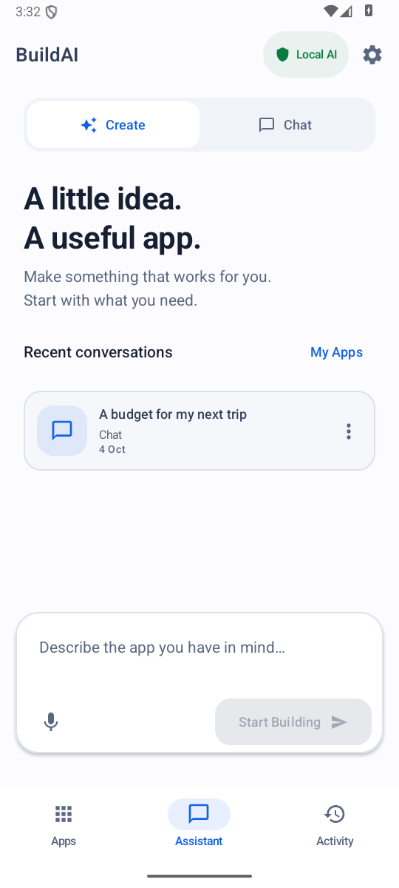
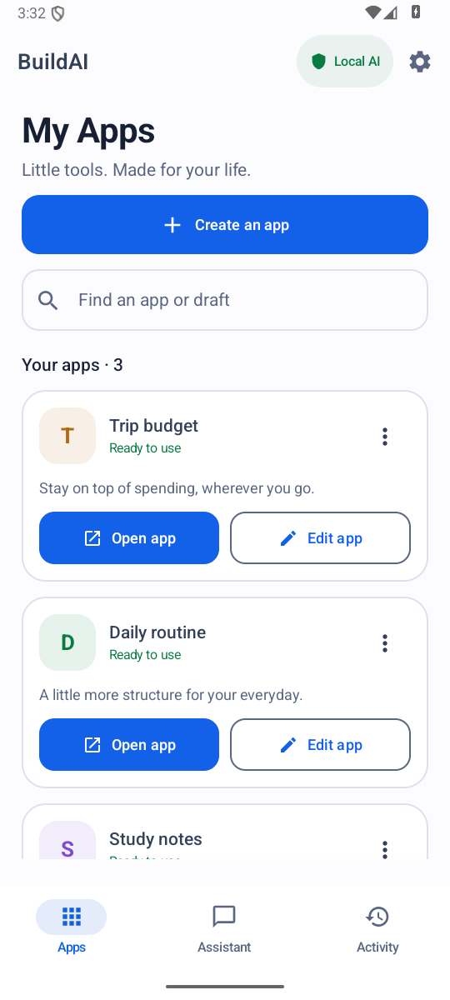
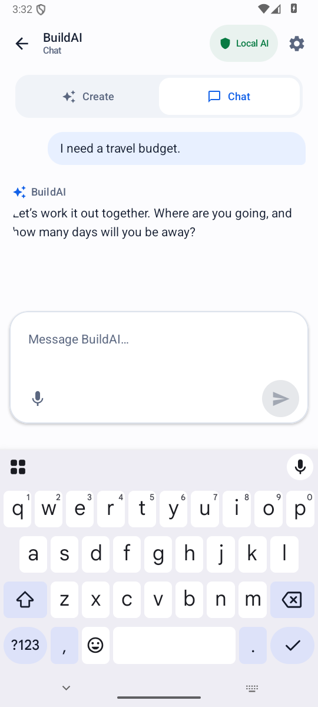
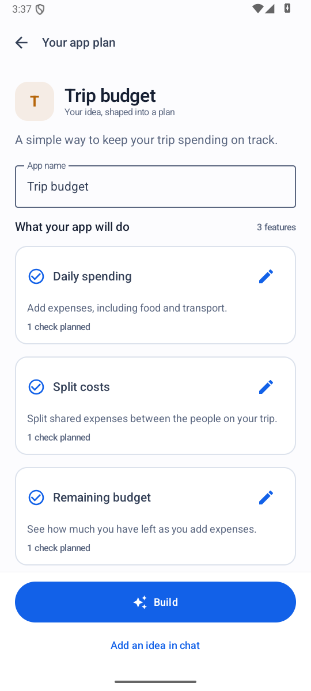

# Implemented screens

These are emulator captures of the real Compose UI. The app library uses temporary sample projects that are removed after the tests. The plan uses controlled planning data; no generation claim is implied.

| Assistant | Apps | Conversation | Plan |
| --- | --- | --- | --- |
|  |  |  |  |

Additional views: [large-text plan](plan-large-text.png), [Activity](activity.png), [Settings](settings.png).

See [research and decisions](../UI_REDESIGN.md). Raw build and device logs are included beside these images.
